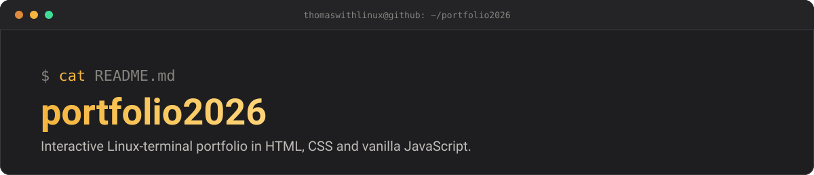

<p align="center">
  
</p>

# portfolio2026 — *Terminal Portfolio, Tuxplorer*


Interactive portfolio styled as a Linux terminal, built with HTML, CSS and
vanilla JavaScript. No framework, no build step.

**Live:** <https://thomaswithlinux.github.io/portfolio2026/>

## Table of contents

- [Features](#features)
- [Available commands](#available-commands)
- [Project structure](#project-structure)
- [Installation](#installation)
- [Deploying to GitHub Pages](#deploying-to-github-pages)
- [Tech stack](#tech-stack)
- [Customization](#customization)
- [Responsive design](#responsive-design)
- [Roadmap](#roadmap)
- [License](#license)
- [Author](#author)

## Features

- Authentic, interactive terminal interface
- Command history with numbering
- History navigation (↑/↓)
- Help system (`--help` / `-h`)
- Real-time clock with date and time
- Dark, professional and minimalist design
- Responsive on every device (mobile, tablet, desktop)
- Custom scrollbar
- Modular code, easy to customize

## Available commands

| Command       | Description                          |
|---------------|--------------------------------------|
| `help` or `?` | Shows the list of commands           |
| `ls`          | Lists the available commands         |
| `whoami`      | Shows personal information           |
| `hostname`    | Shows the portfolio host name        |
| `date`        | Shows the date and time              |
| `skills`      | Shows the technical skills           |
| `about`       | About Thomas Letard                  |
| `projects`    | Lists the current projects           |
| `contact`     | Contact information                  |
| `history`     | Command history                      |
| `clear`       | Clears the terminal and the history  |

### Help on a command

```bash
user@portfolio:~$ whoami --help
Display current user information

user@portfolio:~$ skills -h
Display technical skills and competencies
```

## Project structure

```
portfolio2026/
├── docs/
│   └── banner.svg       # README banner
├── index.html           # Main page
├── index.css            # Styles
├── terminal.js          # Terminal logic
├── time.js              # Real-time clock
├── package.json         # npm configuration (optional)
├── .gitignore           # Files ignored by Git
├── LICENSE              # MIT license
└── README.md            # This file
```

## Installation

### 1. Clone the repository

```bash
git clone https://github.com/thomaswithlinux/portfolio2026.git
cd portfolio2026
```

### 2. Open it locally

Simply open `index.html` in your browser.

### 3. Customize

Edit the following files to add your own information.

**`terminal.js`** — change the commands and their answers:

```javascript
whoami: {
    description: 'Display current user information',
    execute: () => 'Your Name (Your Nickname)\nYour Description'
},
```

## Deploying to GitHub Pages

### Step 1: create a GitHub repository

Create a repository on GitHub and enable **Pages** in its settings
(**Settings → Pages**, source: `main` branch).

### Step 2: initialize Git locally

```bash
git init
git add .
git commit -m "Initial commit: Terminal Portfolio"
git remote add origin https://github.com/{username}/{repository}.git
git branch -M main
git push -u origin main
```

### Step 3: reach your portfolio

- **After about 1–2 minutes**, open `https://{username}.github.io/{repository}/`
- The GitHub Pages URL is also shown in the repository settings

### (Optional) Configure a custom domain

1. **Buy a domain**: Namecheap, OVH, etc.
2. **Add a `CNAME` file** at the root with your domain:
   ```
   your-domain.example
   ```
3. **Configure the DNS** towards GitHub Pages (see the GitHub documentation)
4. **Push**:
   ```bash
   git add CNAME
   git commit -m "Add custom domain"
   git push
   ```

## Tech stack

- **HTML5** — semantic structure
- **CSS3** — responsive design with `clamp()` and media queries
- **JavaScript (vanilla)** — no external dependency
- **Google Fonts** — monospace fonts (Lilex, JetBrains Mono)

## Customization

### Change the information

Edit `terminal.js` and update the `commands` objects:

```javascript
contact: {
    description: 'Display contact information',
    execute: () => `Email: you@example.com
Phone: +00 000 000 000
GitHub: https://github.com/your-username
Website: https://your-site.example`
}
```

### Change the colors

Edit the CSS variables in `index.css`:

```css
:root {
    --bg-black: #0a0a0a;         /* Background */
    --text-gray: #e0e0e0;        /* Text */
    --text-gray-medium: #a0a0a0; /* Secondary text */
    --accent-white: #ffffff;     /* Accent */
}
```

### Add a new command

Add to `terminal.js`:

```javascript
mycommand: {
    description: 'My description',
    execute: () => 'Result of my command'
}
```

## Responsive design

Works on:

- Desktop (1920px+)
- Tablet (768px – 1024px)
- Mobile (480px – 768px)
- Small mobile (360px – 480px)
- Landscape orientation
- All modern browsers

## Roadmap

- [ ] Start-up animations
- [ ] Light/dark theme
- [ ] External API for the projects
- [ ] GitHub API integration
- [ ] PWA (Progressive Web App)
- [ ] Built-in blog
- [ ] Offline mode

## License

Released under the **MIT** license — see the [LICENSE](LICENSE) file.

## Author

**Thomas Letard** — [@thomaswithlinux](https://github.com/thomaswithlinux) ·
[Portfolio](https://thomaswithlinux.github.io/)
Apprentice TSSR · Koumac, New Caledonia
